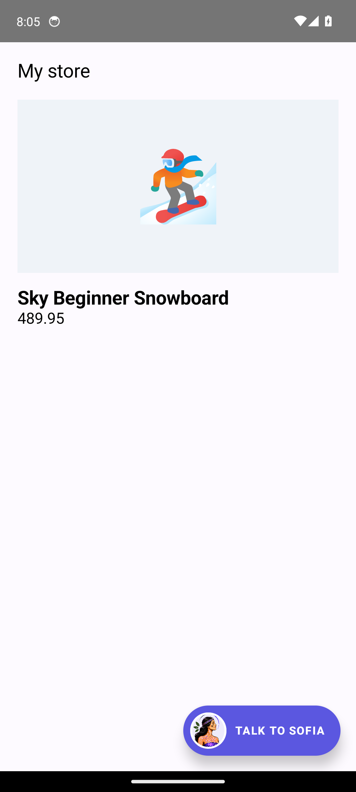
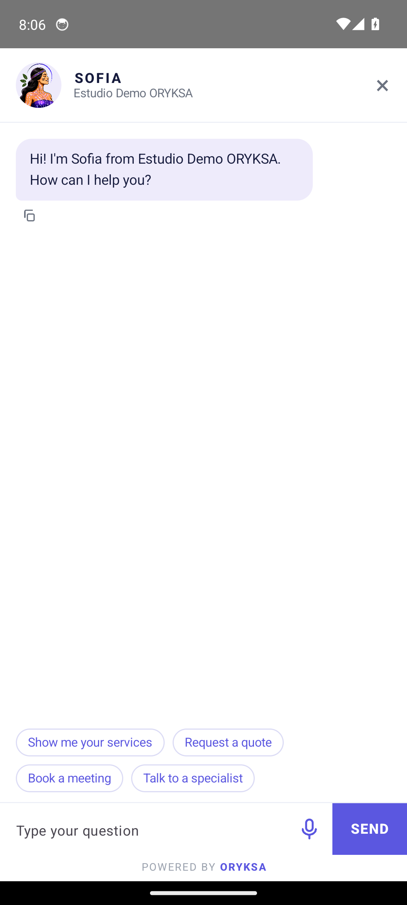
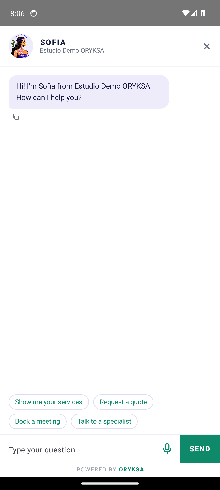
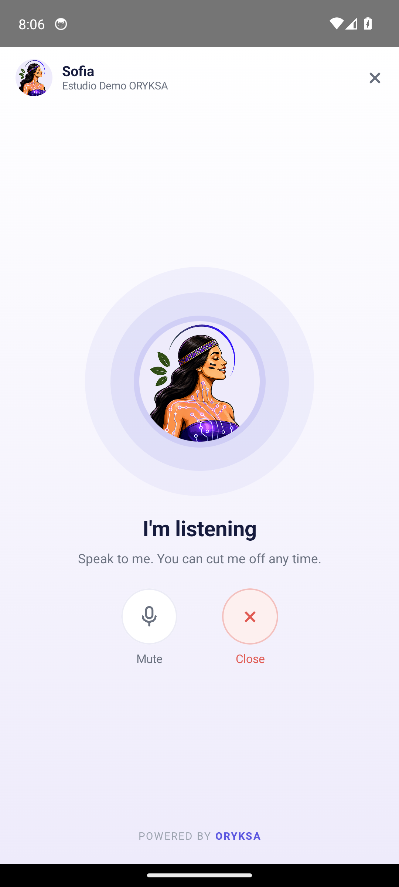

<p align="center"></p>

# ORYKSA for Android (Kotlin)

[](README.md) [](README.pt.md) [](README.es.md) [](README.fr.md)

<p align="center"><a href="https://developer.oryksa.com/es/sdks"></a></p>

SDK oficial de Android de **ORYKSA AI Employees**. Pon dentro de tu app Android un empleado de IA que ya conoce tu negocio: un chat listo en Jetpack Compose (y una actividad lista para apps con Views) con el mismo aspecto que el chat de la web de ORYKSA, el nombre y la foto de tu IA desde tu cuenta ORYKSA, en inglés, portugués y español.

* Documentación: https://developer.oryksa.com/es/sdks
* API: `https://api.oryksa.com/v1`
* Android 6.0 o superior (minSdk 23).

## Capturas de pantalla

<p align="center">   </p>

Pantallas reales de la app de ejemplo de este repositorio, capturadas por el CI en un emulador con una cuenta de prueba de ORYKSA. El chat verde usa el código de *Colores y tema*, más abajo.

## Instalar

Maven Central (no hace falta ningún repositorio adicional):

```kotlin
dependencies {
    implementation("com.oryksa:sdk:1.2.0")
}
```

Alternativa, JitPack (el mismo código, directamente desde GitHub):

```kotlin
// settings.gradle.kts: repositories { maven("https://jitpack.io") }
implementation("com.github.oryksa:oryksa-android:1.2.0")
```

## Para qué sirve

El SDK pone el chat y la voz de ORYKSA dentro de tu app para atender a los **clientes de tu negocio**: preguntan, compran y reservan. La IA responde con tu Brain, tus productos y tus servicios, con el nombre, la foto y la voz que elegiste en *Tu IA*, y guarda leads, reservas y ventas en las Actividades de tu cuenta ORYKSA. **No** es una interfaz para el dueño: a través del SDK nadie cambia ajustes, lee las Actividades ni da órdenes a ORYKSA. Más información: https://help.oryksa.com/es/a/sdks-what-they-do

Las palabrotas que escribe el cliente aparecen con asteriscos en el chat (la misma lista de todos los chats de ORYKSA, cargada desde `https://app.oryksa.com/widget/profanity.json` y guardada 24 horas). Las respuestas de la IA ya vienen filtradas desde el servidor.

## Voz y contexto de la app (1.1)

El chat muestra un micrófono cuando tu plan incluye voz. Abre la pantalla de voz con el mismo comportamiento que la app de ORYKSA: el micrófono sigue abierto mientras ella habla y solo una voz humana la interrumpe (el tecleo, la televisión y su propio eco no); se detiene en la palabra y el texto queda en el chat; a un susurro responde con un susurro; si su voz falla, se muestra el texto (nunca una voz robótica).

Permiso de micrófono: el manifiesto del SDK declara `RECORD_AUDIO`; la pantalla de voz lo pide cuando el cliente la abre.

```kotlin
OryksaChat(client, lang = "pt",
    appContext = { OryksaAppContext(screen = "product", title = "Sky Beginner Snowboard, 489.95") })
```

## Enlaces con botón Abrir (1.1.3)

Los enlaces que da la IA se pueden tocar en el chat (direcciones web y e-mails), y cada enlace web tiene una tarjeta debajo de su respuesta con la foto y el título de la página y un botón **Abrir** (las páginas de tu propio sitio, los dominios de tu chat web; otros sitios muestran la dirección). La pantalla de voz muestra lo que ella dice sin las direcciones, con las mismas tarjetas; tocar Abrir cierra la pantalla de voz. Pasa `onLink` para abrir tus propias pantallas, por ejemplo la página del producto: devuelve true cuando tu app lo abrió, false para que lo abra el navegador.

```kotlin
OryksaChat(client, lang = "es", onLink = { uri ->
    val id = myProductIdOf(uri) ?: return@OryksaChat false // tus rutas
    navController.navigate("product/$id")
    true
})

// Apps con Views: el chat a pantalla completa
OryksaChatActivity.onLink = { uri -> openMyProduct(uri) }
```

`onLink` también está en las dos funciones `OryksaVoiceScreen`.

## Adjuntar una foto o un documento (1.1.3)

El chat tiene un botón de adjuntar (un clip, activado por defecto): una foto del selector de fotos, una foto de la cámara o un documento (PDF, Word, texto, CSV, hasta 8 MB). La IA mira la foto (reducida a 1600 píxeles, JPEG, hasta 2 MB) y lee el documento; la burbuja del cliente muestra la foto, o el icono del documento y su nombre. `attachments = false` oculta el botón (`OryksaChatActivity.attachments = false` para el chat a pantalla completa).

Permisos:

* Galería: ninguno. El SDK usa el selector de fotos de Android (`PickVisualMedia`).
* Cámara: ninguno en la mayoría de las apps. El SDK abre la app de la cámara (`TakePicture`), que no necesita el permiso `CAMERA`, y el SDK no lo declara. Si tu app declara `android.permission.CAMERA` en su propio manifest, Android exige que esté concedido, así que el SDK lo pide antes de abrir la cámara. El manifest del SDK añade su propio FileProvider (`${applicationId}.oryksa.fileprovider`) para la foto de la cámara.
* Documentos: ninguno. Se abren en el selector de documentos del sistema (`OpenDocument`).

```kotlin
OryksaChat(client, lang = "es", attachments = false) // sin botón de adjuntar
// Sin la interfaz:
client.send("Aquí está el presupuesto", file = OryksaFile(pdfBytes, "presupuesto.pdf", "application/pdf"))
```

## Tus funciones de IA: `ai` (1.1.4)

Haz que la IA haga lo que tu app necesita (leer una foto, extraer datos, clasificar, traducir, escribir) y paga con interacciones ORYKSA: 1 por respuesta. Tu prompt y tu JSON Schema viven en tu app; basta el token de sesión (nunca lleves la clave secreta). No crea una conversación en tu bandeja.

```kotlin
val r = client.ai(
    instructions = "Read the tyre on the photo: brand, model and size exactly as written on the sidewall. " +
        "If the size is not legible, readable=false and size=null. Never invent.",
    images = listOf(OryksaImage(jpegBytes)), // resized to 1600 px
    schema = JSONObject("""{"type":"object","properties":{"readable":{"type":"boolean"},"brand":{"type":["string","null"]},"size":{"type":["string","null"]}},"required":["readable","brand","size"]}"""),
)
if (r.json?.optBoolean("readable") == true) showProducts(r.json!!.getString("size"))
```

`r.text` trae la respuesta en texto, `r.json` el objeto (con schema) y `r.interactionsSpent` las interacciones usadas. Cuando se agotan las interacciones del plan, la llamada lanza `OryksaException` con el status 402.

## Apps de TV: `com.oryksa.sdk.tv` (Android TV, Google TV, Fire TV)

Lo que la IA hace en cualquier app de TV, solo con el mando (flechas, OK y Atrás), con letra grande y un foco que se ve desde el sofá. Es Jetpack Compose nativo, sin web view. Los textos, las voces, las reglas y los botones vienen de tu cuenta ORYKSA.

* **Presentadora**: la IA habla en pantalla con una voz nativa en el idioma de quien está mirando, con subtítulos grandes. Las frases que ya dijo vuelven a sonar desde el dispositivo, sin generar una voz nueva, y se cobran otra vez cada vez que las dice.
* **Panel de asistente**: una conversación con la IA pensada para el mando.
* **Voz por el móvil**: muchas TVs no dan micrófono a las apps (el Fire TV Stick no lo da). La TV muestra un código QR, el móvil abre la página de ORYKSA y lo que dice la persona llega a tu app como texto.
* **`client.ai`** para tus propias tareas, por ejemplo moderar o clasificar.

```kotlin
// El dispositivo dice si es un Fire TV o un Android TV (va como `platform`).
val platform = OryksaTvPlatform.detect(context)?.wire ?: "android"
val client = OryksaClient(getToken = { tokenDeTuServidor() }, platform = platform)
val tv = OryksaTv.create(context, client, locale = "es-ES")

setContent {
    // Tu pantalla dentro del host: la presentadora aparece encima, y OK / Atrás la callan mientras habla.
    OryksaPresenterHost(tv) { TuPantalla() }
    if (mostrarAsistente) OryksaTvAssistantDialog(tv, onDismiss = { mostrarAsistente = false })
}

scope.launch { tv.presenter.say("¡Bienvenidos! Soy vuestra presentadora esta noche.") }
scope.launch { tv.presenter.sayGenerated("Anuncia la próxima ronda en una frase corta.", input = "Ronda 2") }
// Solo subtítulos, sin sonido (se cobra al precio de texto; una frase con voz se cobra al precio de voz).
scope.launch { tv.presenter.say("El tema de esta noche: viajes.", voice = false) }

// El móvil como micrófono: muestra OryksaPairingCard(tv) y lee lo que se dice.
scope.launch { tv.phoneVoice.texts.collect { texto -> cuandoElEspectadorDijo(texto) } }
```

* **Sin servidor propio**: `OryksaTv.publicClient(context, chatToken, conversationId)` abre una sesión pública con el token público del chat de tu negocio, y envía `platform` y tu package como `app_id`. Cuando tu negocio limita el chat, debe poner tu package en la lista de apps permitidas. `app_id` es un filtro, no una seguridad fuerte (se puede imitar): la seguridad fuerte es que el token venga de tu propio servidor (`POST /v1/sessions`).
* **Idiomas**: el servidor de ORYKSA elige la voz y los textos para el locale. Hay voces nativas para pt-BR, pt-PT, es-ES, es-419, fr-FR, de-DE, en-US y en-GB, y los demás idiomas usan la voz de inglés de EE. UU.
* **Interacciones**: cada frase de la presentadora se cobra según la tabla de costes de interacción de ORYKSA cada vez que la dice o la muestra (por cada trozo de hasta 600 caracteres), también la frase repetida y la frase solo con subtítulos: la frase con voz al precio de voz y la frase solo con subtítulos al precio de texto. El número exacto viene en la cabecera `X-ORYKSA-Interactions-Spent`, y una frase que el servidor no contó no aparece. Cada texto oído en el móvil, cada respuesta del chat y cada respuesta de `client.ai` también se cobran.
* **Micrófono de la TV**: `OryksaTvMic.isAvailable(context)` dice si el dispositivo tiene una entrada de audio. El SDK nunca pide el permiso en una TV que no la tiene.
* **Diálogos**: Compose no devuelve el foco al botón que abrió un diálogo, y con un mando el foco es la única forma de saber dónde estás. Pasa `returnFocusTo` (el `FocusRequester` de ese botón) a `OryksaTvAssistantDialog` y usa `OryksaTvDialog(onDismiss, returnFocusTo, tv = tv)` en tus propios diálogos: con `tv`, OK y Atrás detienen a la presentadora mientras habla (un diálogo recibe las teclas aparte de tu pantalla).
* **AndroidManifest**: el SDK declara el micrófono como no obligatorio (solo con `RECORD_AUDIO` las tiendas exigirían uno y ocultarían tu app en las TVs sin él). Declara también la pantalla táctil y leanback como no obligatorios, y añade la categoría del lanzador de TV con un banner. Mira `example-tv/`.

```xml
<uses-feature android:name="android.hardware.touchscreen" android:required="false" />
<uses-feature android:name="android.software.leanback" android:required="false" />
<!-- en el intent-filter de la actividad, y android:banner en la application -->
<category android:name="android.intent.category.LEANBACK_LAUNCHER" />
```

Para pruebas y demostraciones, `OryksaTv.create(context, OryksaTvFakeBackend())` lo ejecuta todo sin el servidor. Es simulado, así que no demuestra nada sobre tu cuenta ORYKSA.

## Cómo funciona (y por qué la clave está segura)

1. Tu **servidor** guarda la clave secreta de la API (`oryk_live_...`, creada en developer.oryksa.com) y crea un **token de sesión** de corta duración para cada usuario que ha iniciado sesión, con `POST /v1/sessions`.
2. Tu **app** recibe solo ese token de sesión (`oryk_cs_...`). La clave secreta nunca entra en la app.
3. Cada respuesta de la IA cuenta como una interacción de tu plan ORYKSA, igual que en WhatsApp.

## Jetpack Compose

```kotlin
val client = OryksaClient(getToken = { myBackend.fetchOryksaToken() }) // devuelve "oryk_cs_..."
OryksaChatActivity.client = client

Box(Modifier.fillMaxSize()) {
    MyScreens()
    OryksaChatButton(
        client = client,
        onClick = { OryksaChatActivity.open(context, lang = "en") }, // en, pt, br, es
        modifier = Modifier.align(Alignment.BottomEnd).padding(18.dp),
    )
}
```

O coloca el panel en cualquier lugar con `OryksaChat(client = client)`. Colores: `OryksaChatTheme(accent = Color(0xFF5B57E0))`.

## Apps con Views (Java o Kotlin)

```kotlin
OryksaChatActivity.client = OryksaClient(getToken = { myBackend.fetchOryksaToken() })
button.setOnClickListener { OryksaChatActivity.open(this, "en") }
```

Sin la interfaz (corrutinas): `client.agent()`, `client.sendAndWait("Are you open on Saturday?")`, `client.messages()`.

## Mantén la IA sincronizada con tu app

En tu servidor (por ejemplo con `@oryksa/sdk` en Node): `oryksa.learnApp({ name, description, screens, faq })`.

## Errores

Las llamadas que fallan lanzan `OryksaException` con `status`, `code` (por ejemplo `interaction_limit_reached`, `rate_limited`, `plan_required`) y `message`.

## Colores y tema

`OryksaChatTheme` es una data class con cinco colores: `accent` (botones, burbujas del visitante, enlaces), `ink` (texto principal), `soft` (burbujas de la IA), `background` (panel) y `muted` (texto secundario). Cada uno es un `Color` de Compose y tiene un valor por defecto, así que solo pasas los que quieres cambiar. Pasa el tema a `OryksaChat` y a `OryksaChatButton`.

```kotlin
val theme = OryksaChatTheme(accent = Color(0xFF0E8A6B))

OryksaChat(client = client, theme = theme)
OryksaChatButton(client = client, onClick = { /* open the chat */ }, theme = theme)
```

No hay tema oscuro automático: para el modo oscuro, pasa tus propios colores oscuros. `OryksaChatActivity` (apps con Views) usa los colores por defecto.

---

## Sobre el autor

**Weslley Harakawa** - Fundador de ORYKSA AI. En Lisboa, Portugal. Especialidades: inteligencia artificial, desarrollo web y móvil, tokenización en blockchain. Formación: University of the People.

- LinkedIn: https://www.linkedin.com/in/weslleyharakawa/
- ORYKSA AI Employees: https://oryksa.com (X: https://x.com/oryksa, Instagram: https://www.instagram.com/oryksaai, YouTube: https://www.youtube.com/@ORYKSA)

---

MIT License · ORYKSA AI Employees · W8 Atlantic Unipessoal Lda
