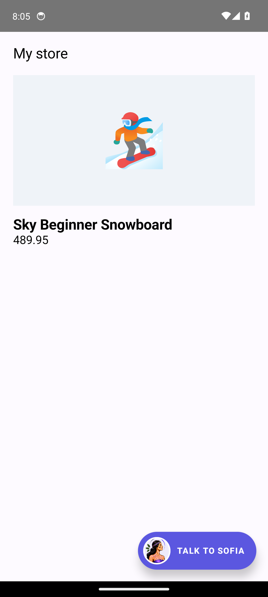
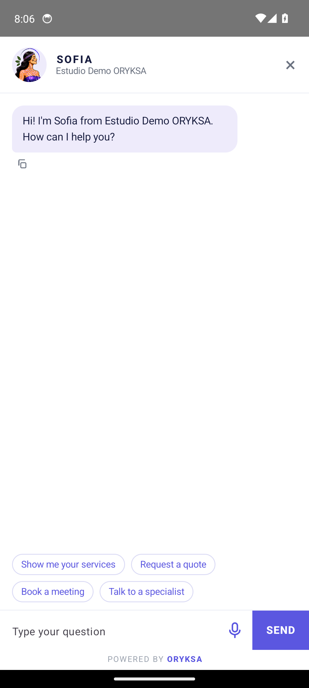
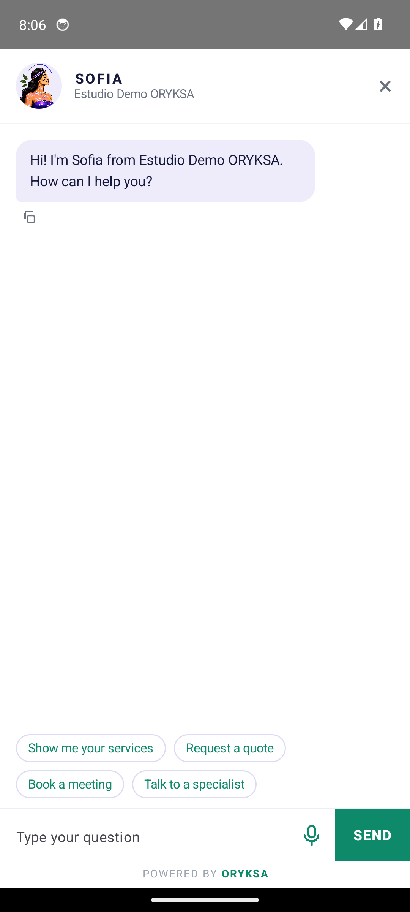
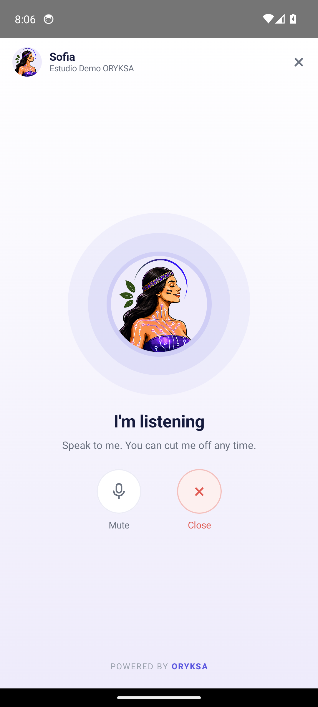

<p align="center"></p>

# ORYKSA for Android (Kotlin)

[](README.md) [](README.pt.md) [](README.es.md) [](README.fr.md)

<p align="center"><a href="https://developer.oryksa.com/fr/sdks"></a></p>

SDK Android officiel d'**ORYKSA AI Employees**. Mettez dans votre app Android un employé IA qui connaît déjà votre entreprise : un chat Jetpack Compose prêt à l'emploi (et une activité prête pour les apps avec Views) identique au chat du site ORYKSA, le nom et la photo de votre IA issus de votre compte ORYKSA, en anglais, portugais et espagnol.

* Documentation : https://developer.oryksa.com/fr/sdks
* API : `https://api.oryksa.com/v1`
* Android 6.0+ (minSdk 23).

## Captures d'écran

<p align="center">   </p>

Écrans réels de l'app d'exemple de ce dépôt, capturés par la CI sur un émulateur avec un compte de test ORYKSA. Le chat vert utilise le code de *Couleurs et thème*, plus bas.

## Installer

Maven Central (aucun dépôt supplémentaire nécessaire) :

```kotlin
dependencies {
    implementation("com.oryksa:sdk:1.1.0")
}
```

Autre option, JitPack (même code, directement depuis GitHub) :

```kotlin
// settings.gradle.kts: repositories { maven("https://jitpack.io") }
implementation("com.github.oryksa:oryksa-android:1.1.0")
```

## À quoi il sert

Le SDK met le chat et la voix ORYKSA dans votre app pour servir les **clients de votre entreprise** : ils posent des questions, achètent et réservent. L'IA répond avec votre Brain, vos produits et vos services, avec le nom, la photo et la voix que vous avez choisis dans *Votre IA*, et enregistre les leads, réservations et ventes dans les Activités de votre compte ORYKSA. Ce n'est **pas** une interface pour le propriétaire : via le SDK, personne ne modifie les paramètres, ne lit les Activités ni ne donne d'ordres à ORYKSA. En savoir plus : https://help.oryksa.com/fr/a/sdks-what-they-do

Les gros mots que le client tape apparaissent sous forme d'astérisques dans le chat (la même liste que tous les chats ORYKSA, chargée depuis `https://app.oryksa.com/widget/profanity.json`, conservée 24 heures). Les réponses de l'IA arrivent déjà filtrées par le serveur.

## Voix et contexte de l'app (1.1)

Le chat affiche un micro quand votre forfait inclut la voix. Il ouvre l'écran vocal avec le même comportement que l'app ORYKSA : le micro reste ouvert pendant qu'elle parle et seule une voix humaine l'interrompt (la frappe au clavier, la télévision et son propre écho ne l'interrompent pas) ; elle s'arrête sur le mot et le texte reste dans le chat ; à un chuchotement, elle répond en chuchotant ; si sa voix échoue, le texte est affiché (jamais une voix robotique).

Autorisation du micro : le manifeste du SDK déclare `RECORD_AUDIO` ; l'écran vocal la demande quand le client l'ouvre.

```kotlin
OryksaChat(client, lang = "pt",
    appContext = { OryksaAppContext(screen = "product", title = "Sky Beginner Snowboard, 489.95") })
```

## Comment ça marche (et pourquoi la clé reste en sécurité)

1. Votre **serveur** garde la clé API secrète (`oryk_live_...`, créée sur developer.oryksa.com) et crée un **jeton de session** de courte durée pour chaque utilisateur connecté avec `POST /v1/sessions`.
2. Votre **app** ne reçoit que ce jeton de session (`oryk_cs_...`). La clé secrète n'entre jamais dans l'app.
3. Chaque réponse de l'IA compte comme une interaction de votre forfait ORYKSA, comme sur WhatsApp.

## Jetpack Compose

```kotlin
val client = OryksaClient(getToken = { myBackend.fetchOryksaToken() }) // renvoie "oryk_cs_..."
OryksaChatActivity.client = client

Box(Modifier.fillMaxSize()) {
    MyScreens()
    OryksaChatButton(
        client = client,
        onClick = { OryksaChatActivity.open(context, lang = "en") }, // en, pt, br, es
        modifier = Modifier.align(Alignment.BottomEnd).padding(18.dp),
    )
}
```

Ou placez le panneau n'importe où avec `OryksaChat(client = client)`. Couleurs : `OryksaChatTheme(accent = Color(0xFF5B57E0))`.

## Apps avec Views (Java ou Kotlin)

```kotlin
OryksaChatActivity.client = OryksaClient(getToken = { myBackend.fetchOryksaToken() })
button.setOnClickListener { OryksaChatActivity.open(this, "en") }
```

Sans l'interface (coroutines) : `client.agent()`, `client.sendAndWait("Are you open on Saturday?")`, `client.messages()`.

## Garder l'IA synchronisée avec votre app

Sur votre serveur (par exemple avec `@oryksa/sdk` sur Node) : `oryksa.learnApp({ name, description, screens, faq })`.

## Erreurs

Les appels qui échouent lèvent `OryksaException` avec `status`, `code` (par exemple `interaction_limit_reached`, `rate_limited`, `plan_required`) et `message`.

## Couleurs et thème

`OryksaChatTheme` est une data class avec cinq couleurs : `accent` (boutons, bulles du visiteur, liens), `ink` (texte principal), `soft` (bulles de l'IA), `background` (panneau) et `muted` (texte secondaire). Chacune est une `Color` Compose avec une valeur par défaut : vous ne passez que celles que vous voulez changer. Passez le thème à `OryksaChat` et à `OryksaChatButton`.

```kotlin
val theme = OryksaChatTheme(accent = Color(0xFF0E8A6B))

OryksaChat(client = client, theme = theme)
OryksaChatButton(client = client, onClick = { /* open the chat */ }, theme = theme)
```

Il n'y a pas de thème sombre automatique : pour le mode sombre, passez vos propres couleurs sombres. `OryksaChatActivity` (apps avec Views) utilise les couleurs par défaut.

---

## À propos de l'auteur

**Weslley Harakawa** - Fondateur d'ORYKSA AI. À Lisbonne, Portugal. Spécialités : intelligence artificielle, développement web et mobile, tokenisation blockchain. Formation : University of the People.

- LinkedIn: https://www.linkedin.com/in/weslleyharakawa/
- ORYKSA AI Employees: https://oryksa.com (X: https://x.com/oryksa, Instagram: https://www.instagram.com/oryksaai, YouTube: https://www.youtube.com/@ORYKSA)

---

MIT License · ORYKSA AI Employees · W8 Atlantic Unipessoal Lda
