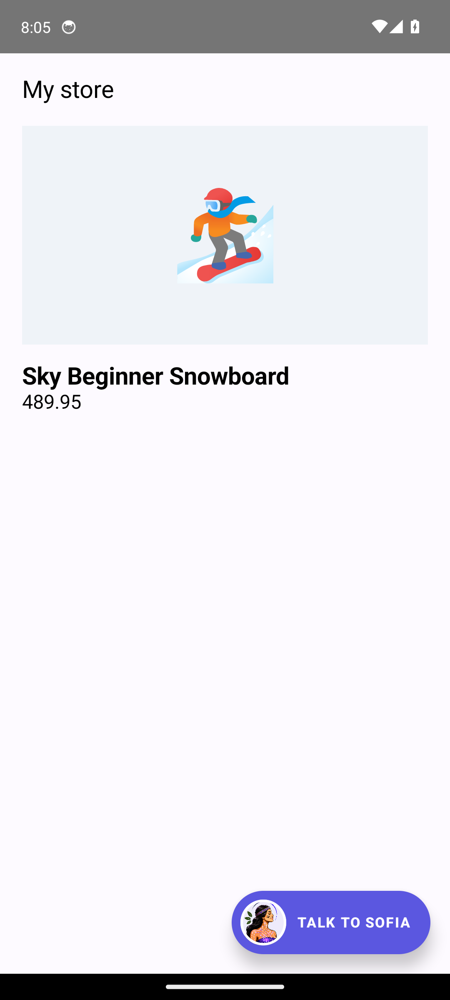
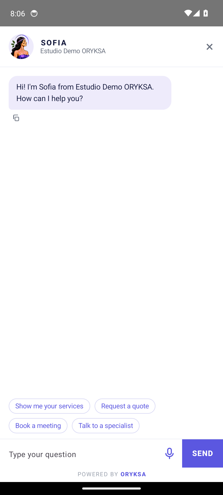
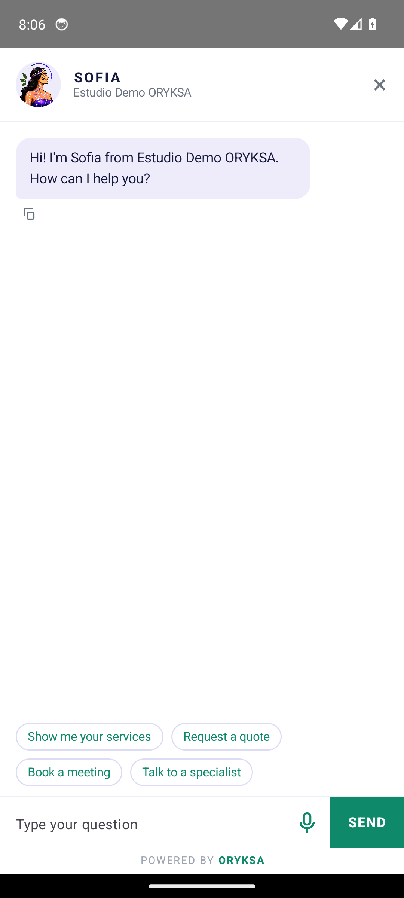
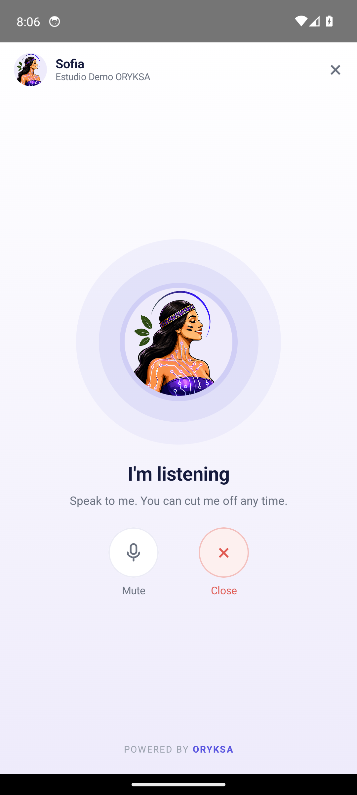

<p align="center"></p>

# ORYKSA for Android (Kotlin)

[](README.md) [](README.pt.md) [](README.es.md) [](README.fr.md)

<p align="center"><a href="https://developer.oryksa.com/en/sdks"></a></p>

Official Android SDK for **ORYKSA AI Employees**. Put an AI employee that already knows your business inside your Android app: a ready Jetpack Compose chat (and a ready activity for apps with Views) with the same look as the ORYKSA website chat, the name and photo of your AI from your ORYKSA account, in English, Portuguese and Spanish.

* Docs: https://developer.oryksa.com/en/sdks
* API: `https://api.oryksa.com/v1`
* Android 6.0+ (minSdk 23).

## Screenshots

<p align="center">   </p>

Real screens of the example app in this repository, taken by CI on an emulator with an ORYKSA test account. The green chat uses the code of *Colours and theme* below.

## Install

Maven Central (no extra repository needed):

```kotlin
dependencies {
    implementation("com.oryksa:sdk:1.1.3")
}
```

Alternative, JitPack (same code, straight from GitHub):

```kotlin
// settings.gradle.kts: repositories { maven("https://jitpack.io") }
implementation("com.github.oryksa:oryksa-android:1.1.3")
```

## What it is for

The SDK puts the ORYKSA chat and voice inside your app to serve the **customers of your business**: they ask, buy and book. The AI answers with your Brain, products and services, with the name, photo and voice you chose in *Your AI*, and saves leads, bookings and sales in the Activities of your ORYKSA account. It is **not** an interface for the owner: nobody changes settings, reads Activities or gives orders to ORYKSA through the SDK. More: https://help.oryksa.com/en/a/sdks-what-they-do

Swear words the customer types show as asterisks in the chat (the same list as every ORYKSA chat, loaded from `https://app.oryksa.com/widget/profanity.json`, kept 24 hours). The AI's replies already come filtered from the server.

## Voice and app context (1.1)

The chat shows a microphone when your plan has voice. It opens the voice screen with the same behaviour as the ORYKSA app: the microphone stays open while she speaks and only a human voice cuts her off (typing, TV and her own echo do not); she stops on the word and the text stays in the chat; a whisper gets a whispered answer; if her voice fails, the text is shown (never a robot voice).

Microphone permission: the SDK manifest declares `RECORD_AUDIO`; the voice screen asks for it when the customer opens it.

```kotlin
OryksaChat(client, lang = "pt",
    appContext = { OryksaAppContext(screen = "product", title = "Sky Beginner Snowboard, 489.95") })
```

## Links with an Open button (1.1.3)

The links the AI gives can be tapped in the chat (web addresses and e-mails), and each web link gets a card under her reply with the picture and title of the page and an **Open** button (the pages of your own site, the domains of your website chat; other sites show the address). The voice screen shows what she says without the addresses, with the same cards; tapping Open closes the voice screen. Pass `onLink` to open your own screens, for example your product page: return true when your app opened it, false to let the browser open it.

```kotlin
OryksaChat(client, lang = "en", onLink = { uri ->
    val id = myProductIdOf(uri) ?: return@OryksaChat false // your routes
    navController.navigate("product/$id")
    true
})

// Apps with Views: the full screen chat
OryksaChatActivity.onLink = { uri -> openMyProduct(uri) }
```

`onLink` is also on both `OryksaVoiceScreen` functions.

## Attach a photo or a document (1.1.3)

The chat has an attach button (a paperclip, on by default): a photo from the photo picker, a photo from the camera, or a document (PDF, Word, text, CSV, up to 8 MB). The AI looks at the photo (made smaller to 1600 pixels, JPEG, up to 2 MB) and reads the document; the customer's bubble shows the photo, or the document icon and its name. `attachments = false` hides the button (`OryksaChatActivity.attachments = false` for the full screen chat).

Permissions:

* Photo library: none. The SDK uses the Android photo picker (`PickVisualMedia`).
* Camera: none in most apps. The SDK opens the camera app (`TakePicture`), which needs no `CAMERA` permission, and the SDK does not declare it. If your app declares `android.permission.CAMERA` in its own manifest, Android requires it to be granted, so the SDK asks for it before it opens the camera. The SDK manifest adds its own FileProvider (`${applicationId}.oryksa.fileprovider`) for the camera photo.
* Documents: none. They open in the system document picker (`OpenDocument`).

```kotlin
OryksaChat(client, lang = "en", attachments = false) // no attach button
// Without the UI:
client.send("Here is the quote", file = OryksaFile(pdfBytes, "quote.pdf", "application/pdf"))
```

## How it works (and why the key stays safe)

1. Your **server** keeps the secret API key (`oryk_live_...`, created at developer.oryksa.com) and creates a short-lived **session token** for each signed-in user with `POST /v1/sessions`.
2. Your **app** receives only that session token (`oryk_cs_...`). The secret key never goes into the app.
3. Every AI reply counts as one interaction of your ORYKSA plan, the same as on WhatsApp.

## Jetpack Compose

```kotlin
val client = OryksaClient(getToken = { myBackend.fetchOryksaToken() }) // returns "oryk_cs_..."
OryksaChatActivity.client = client

Box(Modifier.fillMaxSize()) {
    MyScreens()
    OryksaChatButton(
        client = client,
        onClick = { OryksaChatActivity.open(context, lang = "en") }, // en, pt, br, es
        modifier = Modifier.align(Alignment.BottomEnd).padding(18.dp),
    )
}
```

Or put the panel anywhere with `OryksaChat(client = client)`. Colors: `OryksaChatTheme(accent = Color(0xFF5B57E0))`.

## Apps with Views (Java or Kotlin)

```kotlin
OryksaChatActivity.client = OryksaClient(getToken = { myBackend.fetchOryksaToken() })
button.setOnClickListener { OryksaChatActivity.open(this, "en") }
```

Without the UI (coroutines): `client.agent()`, `client.sendAndWait("Are you open on Saturday?")`, `client.messages()`.

## Keep the AI in sync with your app

On your server (for example with `@oryksa/sdk` on Node): `oryksa.learnApp({ name, description, screens, faq })`.

## Errors

Failed calls throw `OryksaException` with `status`, `code` (for example `interaction_limit_reached`, `rate_limited`, `plan_required`) and `message`.

## Colours and theme

`OryksaChatTheme` is a data class with five colors: `accent` (buttons, visitor bubbles, links), `ink` (main text), `soft` (AI bubbles), `background` (panel) and `muted` (secondary text). Every one is a Compose `Color` and has a default, so you only pass the ones you want to change. Pass the theme to `OryksaChat` and `OryksaChatButton`.

```kotlin
val theme = OryksaChatTheme(accent = Color(0xFF0E8A6B))

OryksaChat(client = client, theme = theme)
OryksaChatButton(client = client, onClick = { /* open the chat */ }, theme = theme)
```

There is no automatic dark theme: for dark mode, pass your own dark colors. `OryksaChatActivity` (apps with Views) uses the default colors.

---

## About the author

**Weslley Harakawa** - Founder of ORYKSA AI. Based in Lisbon, Portugal. Specialties: artificial intelligence, web and mobile development, blockchain tokenization. Education: University of the People.

- LinkedIn: https://www.linkedin.com/in/weslleyharakawa/
- ORYKSA AI Employees: https://oryksa.com (X: https://x.com/oryksa, Instagram: https://www.instagram.com/oryksaai, YouTube: https://www.youtube.com/@ORYKSA)

---

MIT License · ORYKSA AI Employees · W8 Atlantic Unipessoal Lda
