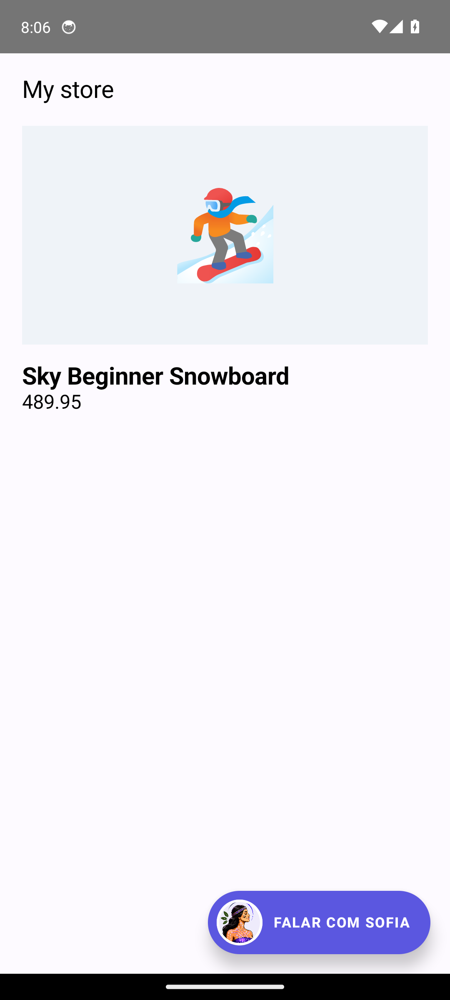
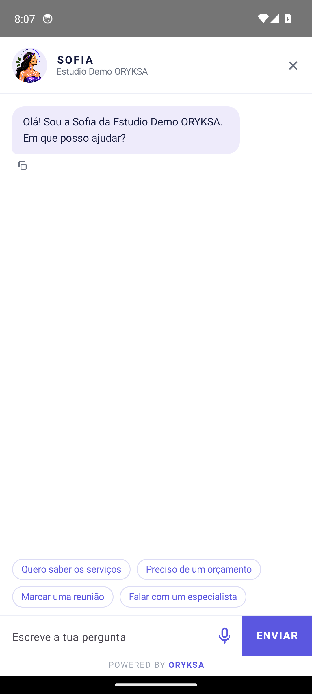
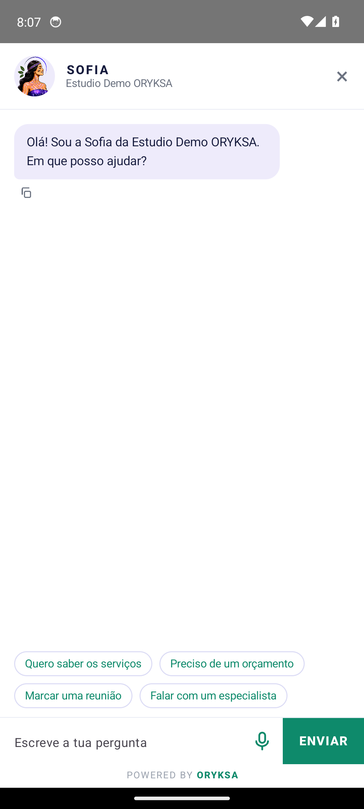
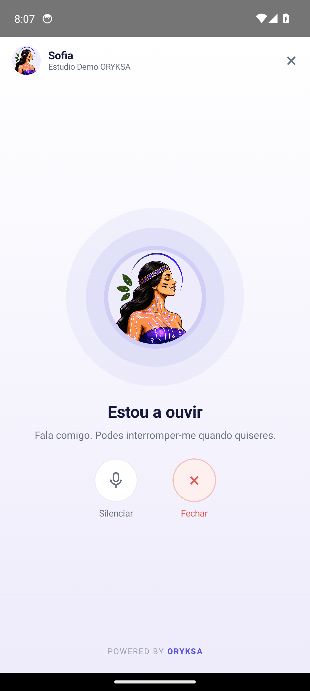

<p align="center"></p>

# ORYKSA for Android (Kotlin)

[](README.md) [](README.pt.md) [](README.es.md) [](README.fr.md)

<p align="center"><a href="https://developer.oryksa.com/pt/sdks"></a></p>

SDK oficial Android da **ORYKSA AI Employees**. Põe dentro da tua app Android um colaborador de IA que já conhece o teu negócio: um chat Jetpack Compose pronto (e uma atividade pronta para apps com Views) com o mesmo aspeto do chat do site da ORYKSA, o nome e a foto da tua IA vindos da tua conta ORYKSA, em inglês, português e espanhol.

* Documentação: https://developer.oryksa.com/pt/sdks
* API: `https://api.oryksa.com/v1`
* Android 6.0+ (minSdk 23).

## Capturas de ecrã

<p align="center">   </p>

Ecrãs reais da app de exemplo deste repositório, captados pelo CI num emulador com uma conta de teste da ORYKSA. O chat verde usa o código de *Cores e tema*, mais abaixo.

## Instalar

Maven Central (não é preciso nenhum repositório extra):

```kotlin
dependencies {
    implementation("com.oryksa:sdk:1.2.0")
}
```

Alternativa, JitPack (o mesmo código, diretamente do GitHub):

```kotlin
// settings.gradle.kts: repositories { maven("https://jitpack.io") }
implementation("com.github.oryksa:oryksa-android:1.2.0")
```

## Para que serve

O SDK põe o chat e a voz da ORYKSA dentro da tua app para atender os **clientes do teu negócio**: eles perguntam, compram e marcam. A IA responde com o teu Brain, os teus produtos e serviços, com o nome, a foto e a voz que escolheste em *A tua IA*, e guarda leads, marcações e vendas nas Atividades da tua conta ORYKSA. **Não** é uma interface para o dono: ninguém altera definições, lê Atividades ou dá ordens à ORYKSA através do SDK. Mais: https://help.oryksa.com/pt/a/sdks-what-they-do

Os palavrões que o cliente escreve aparecem como asteriscos no chat (a mesma lista de todos os chats da ORYKSA, carregada de `https://app.oryksa.com/widget/profanity.json` e guardada durante 24 horas). As respostas da IA já vêm filtradas do servidor.

## Voz e contexto da app (1.1)

O chat mostra um microfone quando o teu plano tem voz. Abre o ecrã de voz com o mesmo comportamento da app ORYKSA: o microfone fica aberto enquanto ela fala e só uma voz humana a interrompe (escrever, a TV e o eco dela própria não); ela para na palavra e o texto fica no chat; um sussurro recebe uma resposta sussurrada; se a voz dela falhar, aparece o texto (nunca uma voz de robô).

Permissão do microfone: o manifesto do SDK declara `RECORD_AUDIO`; o ecrã de voz pede-a quando o cliente o abre.

```kotlin
OryksaChat(client, lang = "pt",
    appContext = { OryksaAppContext(screen = "product", title = "Sky Beginner Snowboard, 489.95") })
```

## Links com botão Abrir (1.1.3)

Os links que a IA dá ficam clicáveis no chat (endereços web e e-mails), e cada link web ganha um cartão por baixo da resposta com a foto e o título da página e um botão **Abrir** (as páginas do teu próprio site, os domínios do teu chat do site; outros sites mostram o endereço). O ecrã de voz mostra o que ela diz sem os endereços, com os mesmos cartões; tocar em Abrir fecha o ecrã de voz. Passa `onLink` para abrir os teus próprios ecrãs, por exemplo a página do produto: devolve true quando a tua app o abriu, false para o navegador o abrir.

```kotlin
OryksaChat(client, lang = "pt", onLink = { uri ->
    val id = myProductIdOf(uri) ?: return@OryksaChat false // as tuas rotas
    navController.navigate("product/$id")
    true
})

// Apps com Views: o chat em ecrã inteiro
OryksaChatActivity.onLink = { uri -> openMyProduct(uri) }
```

`onLink` também existe nas duas funções `OryksaVoiceScreen`.

## Anexar uma foto ou um documento (1.1.3)

O chat tem um botão de anexar (um clipe, ligado por omissão): uma foto do seletor de fotos, uma foto da câmara ou um documento (PDF, Word, texto, CSV, até 8 MB). A IA vê a foto (reduzida a 1600 píxeis, JPEG, até 2 MB) e lê o documento; o balão do cliente mostra a foto, ou o ícone do documento e o nome. `attachments = false` esconde o botão (`OryksaChatActivity.attachments = false` para o chat em ecrã inteiro).

Permissões:

* Galeria: nenhuma. O SDK usa o seletor de fotos do Android (`PickVisualMedia`).
* Câmara: nenhuma na maioria das apps. O SDK abre a app da câmara (`TakePicture`), que não precisa da permissão `CAMERA`, e o SDK não a declara. Se a tua app declarar `android.permission.CAMERA` no seu próprio manifest, o Android exige que esteja concedida, por isso o SDK pede-a antes de abrir a câmara. O manifest do SDK junta o seu próprio FileProvider (`${applicationId}.oryksa.fileprovider`) para a foto da câmara.
* Documentos: nenhuma. Abrem no seletor de documentos do sistema (`OpenDocument`).

```kotlin
OryksaChat(client, lang = "pt", attachments = false) // sem botão de anexar
// Sem a interface:
client.send("Aqui está o orçamento", file = OryksaFile(pdfBytes, "orcamento.pdf", "application/pdf"))
```

## As tuas funções de IA: `ai` (1.1.4)

Põe a IA a fazer o que a tua app precisa (ler uma foto, extrair dados, classificar, traduzir, escrever) e paga com interações ORYKSA: 1 por resposta. O teu prompt e o teu JSON Schema ficam na tua app; basta o token de sessão (nunca leves a chave secreta). Não cria conversa na tua caixa.

```kotlin
val r = client.ai(
    instructions = "Read the tyre on the photo: brand, model and size exactly as written on the sidewall. " +
        "If the size is not legible, readable=false and size=null. Never invent.",
    images = listOf(OryksaImage(jpegBytes)), // resized to 1600 px
    schema = JSONObject("""{"type":"object","properties":{"readable":{"type":"boolean"},"brand":{"type":["string","null"]},"size":{"type":["string","null"]}},"required":["readable","brand","size"]}"""),
)
if (r.json?.optBoolean("readable") == true) showProducts(r.json!!.getString("size"))
```

`r.text` tem a resposta em texto, `r.json` o objeto (com schema) e `r.interactionsSpent` as interações gastas. Quando as interações do plano acabam, a chamada lança `OryksaException` com o status 402.

## Apps de TV: `com.oryksa.sdk.tv` (Android TV, Google TV, Fire TV)

O que a IA faz em qualquer app de TV, só com o comando (setas, OK e Voltar), com letra grande e um foco que se vê do sofá. É Jetpack Compose nativo, sem web view. Os textos, as vozes, as regras e os botões vêm da tua conta ORYKSA.

* **Apresentadora**: a IA fala no ecrã com uma voz nativa na língua de quem está a ver, com legendas grandes. As falas que ela já disse voltam a tocar a partir do aparelho, sem gerar voz nova, e são cobradas outra vez sempre que ela as diz.
* **Painel de assistente**: uma conversa com a IA feita para o comando.
* **Voz pelo telemóvel**: muitas TVs não dão microfone às apps (a Fire TV Stick não dá). A TV mostra um código QR, o telemóvel abre a página da ORYKSA e o que a pessoa diz chega à tua app como texto.
* **`client.ai`** para as tuas próprias tarefas, por exemplo moderar ou classificar.

```kotlin
// O aparelho diz se é uma Fire TV ou uma Android TV (vai como `platform`).
val platform = OryksaTvPlatform.detect(context)?.wire ?: "android"
val client = OryksaClient(getToken = { tokenDoTeuServidor() }, platform = platform)
val tv = OryksaTv.create(context, client, locale = "pt-PT")

setContent {
    // O teu ecrã dentro do host: a apresentadora aparece por cima, e o OK / Voltar calam-na enquanto fala.
    OryksaPresenterHost(tv) { OTeuEcra() }
    if (mostrarAssistente) OryksaTvAssistantDialog(tv, onDismiss = { mostrarAssistente = false })
}

scope.launch { tv.presenter.say("Bem-vindos! Sou a vossa apresentadora esta noite.") }
scope.launch { tv.presenter.sayGenerated("Anuncia a próxima ronda numa frase curta.", input = "Ronda 2") }
// Só legendas, sem som (cobrada ao preço de texto; uma fala com voz é cobrada ao preço de voz).
scope.launch { tv.presenter.say("O tema desta noite: viagens.", voice = false) }

// O telemóvel como microfone: mostra o OryksaPairingCard(tv) e lê o que é dito.
scope.launch { tv.phoneVoice.texts.collect { texto -> quandoOEspectadorDisse(texto) } }
```

* **Sem servidor próprio**: `OryksaTv.publicClient(context, chatToken, conversationId)` abre uma sessão pública com o token público do chat do teu negócio, e manda o `platform` e o teu package como `app_id`. Quando o teu negócio limita o chat, tem de pôr o teu package na lista de apps permitidas. O `app_id` é um filtro, não é segurança forte (pode ser imitado): a segurança forte é o token vir do teu próprio servidor (`POST /v1/sessions`).
* **Línguas**: o servidor da ORYKSA escolhe a voz e os textos para o locale. Há vozes nativas para pt-BR, pt-PT, es-ES, es-419, fr-FR, de-DE, en-US e en-GB, e as outras línguas usam a voz de inglês dos EUA.
* **Interações**: cada fala da apresentadora é cobrada pela tabela de custos de interação da ORYKSA sempre que ela a diz ou a mostra (por cada pedaço de até 600 caracteres), também a fala repetida e a fala só com legendas: a fala com voz ao preço de voz e a fala só com legendas ao preço de texto. O número exato vem no cabeçalho `X-ORYKSA-Interactions-Spent`, e uma fala que o servidor não contou não aparece. Cada texto ouvido no telemóvel, cada resposta do chat e cada resposta do `client.ai` também são cobrados.
* **Microfone da TV**: `OryksaTvMic.isAvailable(context)` diz se o aparelho tem uma entrada de áudio. O SDK nunca pede a permissão numa TV que não a tem.
* **Diálogos**: o Compose não devolve o foco ao botão que abriu um diálogo, e com um comando o foco é a única forma de saber onde se está. Passa `returnFocusTo` (o `FocusRequester` desse botão) ao `OryksaTvAssistantDialog` e usa `OryksaTvDialog(onDismiss, returnFocusTo, tv = tv)` nos teus próprios diálogos: com `tv`, o OK e o Voltar calam a apresentadora enquanto ela fala (um diálogo recebe as teclas à parte do teu ecrã).
* **AndroidManifest**: o SDK declara o microfone como não obrigatório (só com o `RECORD_AUDIO` as lojas exigiriam um e escondiam a tua app nas TVs sem ele). Declara também o ecrã tátil e o leanback como não obrigatórios, e acrescenta a categoria do lançador de TV com um banner. Vê `example-tv/`.

```xml
<uses-feature android:name="android.hardware.touchscreen" android:required="false" />
<uses-feature android:name="android.software.leanback" android:required="false" />
<!-- no intent-filter da atividade, e android:banner na application -->
<category android:name="android.intent.category.LEANBACK_LAUNCHER" />
```

Para testes e demonstrações, `OryksaTv.create(context, OryksaTvFakeBackend())` corre tudo sem o servidor. É simulado, por isso não prova nada sobre a tua conta ORYKSA.

## Como funciona (e porque é que a chave fica segura)

1. O teu **servidor** guarda a chave secreta da API (`oryk_live_...`, criada em developer.oryksa.com) e cria um **token de sessão** de curta duração para cada utilizador com sessão iniciada, com `POST /v1/sessions`.
2. A tua **app** recebe só esse token de sessão (`oryk_cs_...`). A chave secreta nunca entra na app.
3. Cada resposta da IA conta como uma interação do teu plano ORYKSA, tal como no WhatsApp.

## Jetpack Compose

```kotlin
val client = OryksaClient(getToken = { myBackend.fetchOryksaToken() }) // devolve "oryk_cs_..."
OryksaChatActivity.client = client

Box(Modifier.fillMaxSize()) {
    MyScreens()
    OryksaChatButton(
        client = client,
        onClick = { OryksaChatActivity.open(context, lang = "en") }, // en, pt, br, es
        modifier = Modifier.align(Alignment.BottomEnd).padding(18.dp),
    )
}
```

Ou coloca o painel em qualquer sítio com `OryksaChat(client = client)`. Cores: `OryksaChatTheme(accent = Color(0xFF5B57E0))`.

## Apps com Views (Java ou Kotlin)

```kotlin
OryksaChatActivity.client = OryksaClient(getToken = { myBackend.fetchOryksaToken() })
button.setOnClickListener { OryksaChatActivity.open(this, "en") }
```

Sem a interface (corrotinas): `client.agent()`, `client.sendAndWait("Are you open on Saturday?")`, `client.messages()`.

## Mantém a IA sincronizada com a tua app

No teu servidor (por exemplo com `@oryksa/sdk` em Node): `oryksa.learnApp({ name, description, screens, faq })`.

## Erros

As chamadas falhadas lançam `OryksaException` com `status`, `code` (por exemplo `interaction_limit_reached`, `rate_limited`, `plan_required`) e `message`.

## Cores e tema

O `OryksaChatTheme` é uma data class com cinco cores: `accent` (botões, balões do visitante, ligações), `ink` (texto principal), `soft` (balões da IA), `background` (painel) e `muted` (texto secundário). Cada uma é uma `Color` do Compose e tem um valor por omissão, por isso só passas as que queres mudar. Passa o tema a `OryksaChat` e a `OryksaChatButton`.

```kotlin
val theme = OryksaChatTheme(accent = Color(0xFF0E8A6B))

OryksaChat(client = client, theme = theme)
OryksaChatButton(client = client, onClick = { /* open the chat */ }, theme = theme)
```

Não há tema escuro automático: para o modo escuro, passa as tuas próprias cores escuras. A `OryksaChatActivity` (apps com Views) usa as cores por omissão.

---

## Sobre o autor

**Weslley Harakawa** - Fundador da ORYKSA AI. Em Lisboa, Portugal. Especialidades: inteligência artificial, desenvolvimento web e mobile, tokenização em blockchain. Formação: University of the People.

- LinkedIn: https://www.linkedin.com/in/weslleyharakawa/
- ORYKSA AI Employees: https://oryksa.com (X: https://x.com/oryksa, Instagram: https://www.instagram.com/oryksaai, YouTube: https://www.youtube.com/@ORYKSA)

---

MIT License · ORYKSA AI Employees · W8 Atlantic Unipessoal Lda
